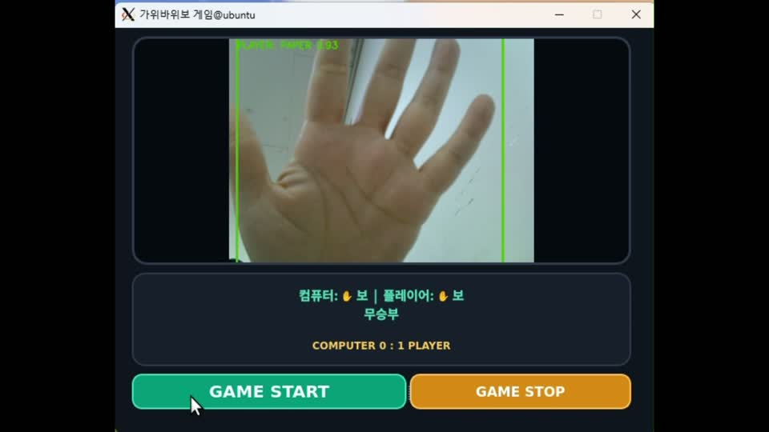

# RCP_game_project

Jetson Orin Nano에서 카메라로 손동작을 인식하는 **온디바이스 AI 가위바위보 게임**입니다. YOLO11n 기반 모델을 TensorRT 엔진으로 실행하고, OpenCV로 영상을 처리합니다. PyQt5 GUI에서는 컴퓨터와 대결하는 1인용과 두 사람이 대결하는 2인용을 지원합니다.

## 시연 영상

[](assets/rcp_game_project.mp4)

**[시연 영상 보기 · MP4](assets/rcp_game_project.mp4)** — 약 29초, 1920 × 1080. 미리보기 이미지를 클릭하면 영상 파일로 이동합니다. 사용하는 뷰어에서 재생되지 않으면 다운로드하여 확인하세요.

## 주요 기능

| 기능 | 구현 내용 |
| --- | --- |
| 손동작 인식 | 가위(`SCISSORS`), 바위(`ROCK`), 보(`PAPER`) 검출 및 신뢰도 표시 |
| 1인용 · GUI | 신뢰도가 가장 높은 손을 선택하고, 무작위로 동작을 고르는 컴퓨터와 대결 |
| 2인용 · GUI/OpenCV | 왼쪽은 Player 1, 오른쪽은 Player 2로 구분하고 각 영역에서 신뢰도가 가장 높은 손 선택 |
| 판정 안정화 | 최근 7프레임 중 같은 동작이 5회 이상 검출될 때 유효한 동작으로 판정 |
| 라운드 진행 | 3초 카운트다운 후 승패 판정, 승리한 쪽의 점수 누적 |
| 자동 진행 · GUI | 결과를 1.5초간 표시한 뒤 다음 라운드 시작 |

화면은 거울처럼 좌우 반전됩니다. 2인용에서는 **표시되는 화면 기준**으로 중앙선 양쪽에 손을 하나씩 놓고 카운트다운 동안 동작을 유지하세요. 손이 없거나 판정이 불안정하면 해당 라운드는 점수를 부여하지 않습니다. 무승부도 점수가 올라가지 않습니다.

## 구성 및 처리 흐름

```text
카메라 입력 → 좌우 반전 → RGB 변환·Letterbox·정규화
            → TensorRT 추론 → 신뢰도 필터·클래스별 NMS
            → 플레이어별 손 선택 → 최근 프레임 기반 동작 안정화
            → 카운트다운 종료 시 승패 판정 → 화면 및 점수 갱신
```

`trt_module.py`는 TensorRT의 이름 기반 텐서 API와 `execute_async_v3`를 사용합니다. PyCUDA로 할당한 매핑 메모리를 텐서 주소에 연결하고, CUDA 스트림을 동기화한 뒤 결과를 반환합니다. 현재 구현은 고정 크기 입력 및 단일 입력·출력 텐서를 전제로 합니다.

```text
RCP_game_project/
├── README.md
├── rps_game.py                 # OpenCV 2인용 게임 및 공통 검출·판정 로직
├── rps_game_gui.py             # PyQt5 1인용/2인용 GUI
├── trt_module.py               # TensorRT 추론 및 PyCUDA 메모리 관리
├── rps_game_yolo11n.onnx       # 엔진 변환에 사용하는 모델
├── ui/
│   ├── __init__.py
│   ├── rsp_game.ui             # Qt Designer UI 원본
│   └── ui_rsp_game.py          # Python UI 코드
└── assets/
    ├── demo-preview.jpg       # 시연 영상 미리보기
    └── rcp_game_project.mp4   # 시연 영상
```

`rps_game_yolo11n_fp16.engine`은 실행 장치에서 생성해야 하며, `.gitignore`에 의해 저장소에서 제외됩니다. 학습 스크립트와 학습 데이터는 이 폴더에 포함되어 있지 않습니다.

## 실행 환경 및 준비

- Jetson Orin Nano와 CUDA/TensorRT 실행 환경
- TensorRT 10.x API를 제공하는 Python 환경 및 PyCUDA
- Python 3, NumPy, OpenCV(`cv2`), GUI 실행 시 PyQt5
- OpenCV에서 접근 가능한 카메라와 GUI를 표시할 디스플레이 환경

JetPack에 맞는 CUDA/TensorRT 환경을 먼저 준비하고, 같은 Python 환경에서 필요한 모듈을 확인합니다.

```bash
python3 -c "import cv2, numpy, tensorrt, pycuda.driver; print('Core imports OK')"
python3 -c "from PyQt5.QtWidgets import QApplication; print('PyQt5 import OK')"
```

OpenCV 버전은 `cv2.imshow`를 사용하므로 GUI 기능이 있는 빌드가 필요합니다. PyQt5는 GUI 버전을 실행할 때만 필요합니다.

### TensorRT 엔진 생성

Jetson 터미널에서 프로젝트 폴더로 이동한 뒤 포함된 ONNX 모델을 변환합니다.

```bash
cd RCP_game_project
/usr/src/tensorrt/bin/trtexec \
  --onnx=rps_game_yolo11n.onnx \
  --saveEngine=rps_game_yolo11n_fp16.engine \
  --fp16
```

위 경로에 `trtexec`가 없으면 설치된 TensorRT의 실행 파일 경로를 사용하세요. 엔진이 로딩되지 않거나 실행 장치·JetPack/TensorRT 환경이 바뀐 경우, 대상 Jetson에서 다시 생성하세요. 두 실행 파일 모두 스크립트가 있는 폴더의 엔진을 읽습니다.

## 실행 및 조작

### PyQt5 GUI · 1인용/2인용

```bash
python3 rps_game_gui.py
```

1. 메뉴에서 **1인용** 또는 **2인용**을 선택합니다.
2. 카메라에 손을 보여주고 **GAME START**를 누릅니다.
3. 3초 카운트다운과 승패 판정이 자동으로 반복됩니다.
4. **GAME STOP**을 누르면 카메라를 해제하고 모드 선택 메뉴로 돌아갑니다.

각 모드의 점수는 별도로 관리하며, 메뉴로 돌아가도 유지됩니다. GUI에는 별도의 점수 초기화 버튼이 없으며 프로그램을 다시 실행하면 초기화됩니다. 창을 닫으면 종료됩니다.

### OpenCV 창 · 2인용

```bash
python3 rps_game.py
```

| 키 | 동작 |
| --- | --- |
| `Space` | 3초 카운트다운으로 한 라운드 시작 |
| `R` | 양쪽 점수 초기화 |
| `Q` / `Esc` | 종료 |

OpenCV 버전은 라운드마다 `Space`를 눌러 시작하며, 결과는 3초 동안 표시됩니다. 키 입력은 게임 창에 포커스를 두고 영문 소문자 입력 상태에서 사용하세요.

### XLaunch로 화면을 표시하는 경우

Windows에서 XLaunch를 실행하고, 게임을 실행하는 터미널에서 X 서버에 접근할 수 있도록 `DISPLAY`를 설정합니다. `<WINDOWS_IP>`는 Windows 호스트 IP로 바꿉니다.

```bash
export DISPLAY=<WINDOWS_IP>:0.0
python3 rps_game_gui.py
```

이 설정은 화면 출력 대상만 바꿉니다. 추론과 카메라 접근은 Python을 실행하는 장치에서 이루어지므로, 게임은 CUDA/TensorRT와 카메라가 준비된 Jetson에서 실행하세요. SSH X11 포워딩을 사용하는 경우에는 SSH가 설정한 `DISPLAY`를 사용합니다.

## 기본 설정

다음 값은 `rps_game.py`에 정의되어 있으며 GUI에서도 공통으로 사용합니다.

| 설정 | 기본값 | 의미 |
| --- | --- | --- |
| `CAMERA_ID` | `0` | OpenCV 카메라 장치 번호 |
| `CAMERA_WIDTH` / `CAMERA_HEIGHT` | `640` / `480` | 카메라에 요청하는 해상도 |
| `CONFIDENCE_THRESHOLD` | `0.50` | 검출 신뢰도 기준 |
| `IOU_THRESHOLD` | `0.45` | 클래스별 NMS 기준 |
| `STABLE_FRAMES` | `7` | 동작 판정에 사용하는 최근 프레임 수 |
| `CLASS_NAMES` | `0: 가위`, `1: 바위`, `2: 보` | 모델 출력 클래스 순서 |

다른 모델로 교체할 때는 클래스 순서와 출력 형식이 현재 후처리 코드와 일치해야 합니다. GUI 타이머 간격은 30ms이지만, 실제 처리 속도는 추론 시간과 카메라 환경에 따라 달라집니다.

## 문제 해결

- **엔진 파일을 찾지 못함 / 로딩 실패:** 파일명과 위치를 확인하고 대상 Jetson 환경에서 엔진을 다시 생성합니다.
- **카메라를 열 수 없음:** 카메라 연결, 다른 프로그램의 사용 여부, `CAMERA_ID`를 확인합니다.
- **손 인식 실패:** 조명을 확보하고 손 전체가 화면 안에 들어오게 합니다. 2인용에서는 손을 서로 다른 화면 영역에 놓고 같은 동작을 유지합니다.
- **Qt 플랫폼 플러그인 오류:** GUI 코드에서 OpenCV가 설정한 Qt 플러그인 경로를 PyQt5 경로로 조정합니다. 오류가 계속되면 PyQt5 설치 상태와 디스플레이 연결을 확인합니다.
- **화면이 나타나지 않음:** 로컬 디스플레이 또는 X 서버 연결과 `DISPLAY` 설정을 확인합니다.
